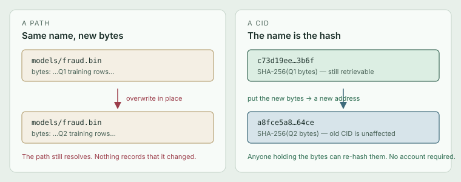
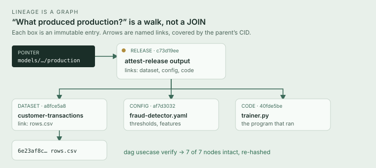
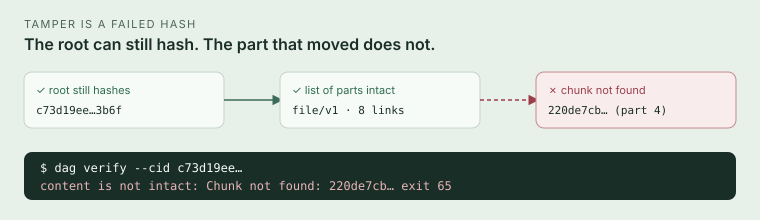
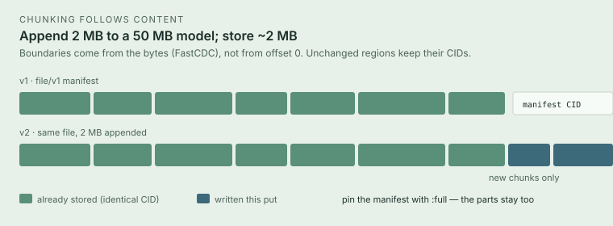
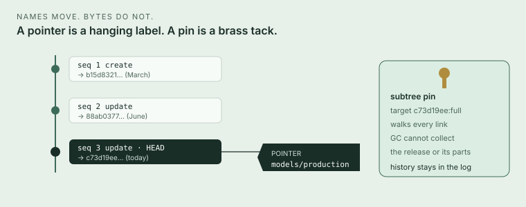

# i-like-dags

**Prove what a system produced — from a name, to every byte — without
trusting the system that produced it.**

A content-addressed DAG in one binary and one directory. No daemon. The
identifier of a chunk *is* the SHA-256 of its bytes, so a reference cannot
silently start meaning something else. Pointers give moving names an
append-only history. Pins express retention as data. Jobs record the exact
inputs they resolved. `dag verify` walks the graph and re-hashes it.

```bash
cargo build --release
./target/release/dag usecase seed
./target/release/dag usecase verify    # 7 of 7 nodes intact
./target/release/dag serve             # http://127.0.0.1:8080
```

That last command is a loopback console. The public listener is
`dag content serve` (GET-by-CID, no writes).

## The question this is for

Six months later, someone asks:

> Which exact dataset, configuration and code produced the model that was
> live on 12 March — and prove none of it has been altered since.

A path in object storage, a row in a metadata database, a tag in a model
registry can all be edited. An edit leaves no trace that anyone *outside*
those systems can check. “Prove” becomes “trust our audit table”.

Content addressing turns the question around. If the name *is* the hash,
then:

- a reference cannot be retargeted without changing the name
- anyone holding the bytes can check them, with no account
- “what did this depend on” is a set of immutable links, not foreign keys
  into a mutable table



What content addressing does *not* give you is a way to say “the current
production model”, or a way to stop a cleanup job deleting last year’s
evidence. That is what the rest of this system is for.

## Lineage is a graph

An **entry** is a payload plus named **links** to other CIDs. Links live
inside the entry’s bytes, so they are covered by its CID: you cannot change
what a card points at without changing what the card *is*. A release is
then a walk from a name to every artefact it depended on.



```
$ dag usecase verify
provenance for models/fraud-detector/production
  ✓ c73d19ee…3b6f (root)
    ✓ a8fce5a8…64ce datasets/customer-transactions
    ✓ af7d3032…d3fe configs/fraud-detector
    ✓ 40fde5be…e436 code/fraud-detector
      ✓ 6e23af8c…57f5 rows.csv
      ✓ 88ab0377…d4e0 supersedes
        ✓ b15d8321…562f rows.csv

7 of 7 nodes intact, 2451 bytes, retention: protected
```

The walk is the proof. `./scripts/demo.sh` runs the same story and then
flips a bit on disk so you can watch verification name the part that moved.



`dag verify` re-hashes every part of a `file/v1` manifest (`verify_deep`).
A root that hashes while an interior chunk is gone is a failed verification,
exit 65 — not a green tick over a list of names.

Worked example: [`docs/USE_CASE.md`](docs/USE_CASE.md). Other domains the
same primitives fit, and the ones they do not:
[`docs/ALL_USE_CASES.md`](docs/ALL_USE_CASES.md).

## Large artefacts share what did not change

The 4 MiB limit is per *chunk*, not per file. `dag put` splits anything
larger with FastCDC (256 KiB / 1 MiB / 4 MiB) behind a `file/v1` manifest.
`dag get` reassembles and re-hashes every byte. Because boundaries come
from the content, revision N+1 stores only what changed.



One subtree pin (`--target <manifest>:full`) retains the whole file, not
just the list of parts.

## Names can move. History cannot.

A **pointer** is the one mutable thing: a name that resolves to a CID
today. Updates append to a log. `dag pointer history` is what the name has
ever meant — including 12 March.

A **pin** is retention as data. Collection honours the union of live
pointer-head closures, pins, and the control plane’s own logs. When it
cannot enumerate a pinned subtree, it refuses rather than collecting the
remainder.



Jobs sit on the same graph. Admission freezes the filed spec revision and
the resolved inputs into an immutable run manifest. Deterministic jobs
reproduce. Side-effecting jobs reuse first-run artefacts (the effect key
is config plus those inputs). Signatures add *who*: Ed25519 over
[DSSE](https://github.com/secure-systems-lab/dsse) / [in-toto](https://in-toto.io)
envelopes, stored as ordinary entries. A trusted verdict is computed only
against *your* keyring’s copy of the key.

## Model

| Concept | What it is | Mutable? |
|---|---|---|
| **Chunk** | Bytes, ≤ 4 MiB, addressed by their SHA-256 | never |
| **Entry** | A payload plus named links to other CIDs (CBOR) | never |
| **File** | A bounded manifest over content-defined chunks | never |
| **Pointer** | A name resolving to a CID, with full history | yes, append-only |
| **Pin** | Retention over a CID or its subtree, with scope and TTL | via events |
| **Job** | An adapter over resolved inputs, recorded per run | — |
| **Event** | One journal of every change above | append-only |

Everything lives under one data directory (default `.dag`):

```
.dag/
  data/          chunk bytes, sharded by CID prefix
  control.redb   index, pointer/pin/job logs, journal, recovery flags
  keys/          Ed25519 seeds — mode 0700 / 0600, never replicated
```

One process per directory. `dag serve` is a loopback viewer;
`dag content serve` is the public read-only plane;
`dag node serve` is the authenticated gRPC port other nodes talk to.

## Try it

```bash
cargo build --release
./target/release/dag usecase seed
./target/release/dag usecase verify
./scripts/demo.sh
```

Ready-made job specs: `crates/dag-cli/examples/`. `dag job adapters` marks
simulated doubles; there is no HTTP fetch adapter.

```bash
dag put --data "hello"                    # or --file / --stdin
dag get --cid <CID> --out ./out.bin
dag pointer create|update|resolve|history|list
dag pin     create|deactivate|list|info
dag job     create|trigger|run-once|runs
dag sign    --cid <CID> --key <name>
dag verify  --cid <CID>                   # intact + trusted signature, or 65
dag sync    push|pull --remote <dir|grpcs://…|https://…>
dag node    serve --listen 127.0.0.1:7411
dag serve   --addr 127.0.0.1:8080
dag content serve --addr 0.0.0.0:8081
dag backup  create|verify|restore
```

`--json` on any command. Exit codes follow BSD sysexits (`66` not found,
`65` bad data / failed verify, `77` capability not granted, `78` recovery
incomplete).

> **`exec` is not a sandbox.** The CLI compiles it in and grants nothing
> until `--allow-exec` / `--allow-exec-jobs`. It is never reachable through
> the HTTP API. Hostile programs still have the host user’s authority
> unless you run the worker in a VM or container.

> **`dag serve` has no authentication on loopback**, by decision. A
> non-loopback bind without `--expose-control` is refused. Browser requests
> that are cross-site (`Sec-Fetch-Site`) are refused; CORS is not
> permissive. Put a proxy in front if the control plane must be reachable
> from elsewhere.

How to run a node: [`docs/runbooks/operations.md`](docs/runbooks/operations.md).
Shape and open choices: [`docs/SYSTEM_OVERVIEW.md`](docs/SYSTEM_OVERVIEW.md).

## Crates

```
dag-core      CIDs, entries, files, pointers, pins, jobs, MemoryStore
dag-storage   filesystem store, redb index, collector
dag-control   Control::open — logs, retention, recovery, sync
dag-jobs      adapters and the run lifecycle
dag-api       HTTP API, SSE, embedded console
dag-net       authenticated gRPC node protocol
dag-cli       the `dag` binary
dag-wasm      wasm-bindgen verifier over dag-core
dag-edge      Cloudflare Worker source (not a hosted service)
```

## Development

See [CONTRIBUTING.md](CONTRIBUTING.md).

```bash
cargo test --locked --workspace --all-features
RUSTFLAGS='-D warnings' cargo clippy --locked --workspace --all-targets --all-features
cargo fmt --all -- --check
cd crates/dag-api/web && npm run check
```

Prefer `dag_control::test_utils::TestControl` (feature `test-utils`) over
shelling out to the CLI.

## Invariants

- **I1** content for a CID never changes
- **I2** chunks are ≤ 4 MiB
- **I3** an entry’s links are immutable once published
- **I4** pointers mutate only by appending to their log
- **I5** retention is data, not configuration
- **I6** collection honours effective retention
- **R6** when collection is uncertain, retain
- **I7** deterministic jobs reproduce their outputs
- **I8** side-effecting jobs reuse first-run artefacts
- **I9** storage nodes operate on chunks and never parse the DAG
- **I10** the external interface is CIDs and pointers; deref is opt-in

## License

Copyright 2026 Laurence Avent.

Apache License, Version 2.0. See [`LICENSE`](LICENSE).
Contributions: [`CONTRIBUTING.md`](CONTRIBUTING.md).
Vulnerabilities: [`SECURITY.md`](SECURITY.md).
